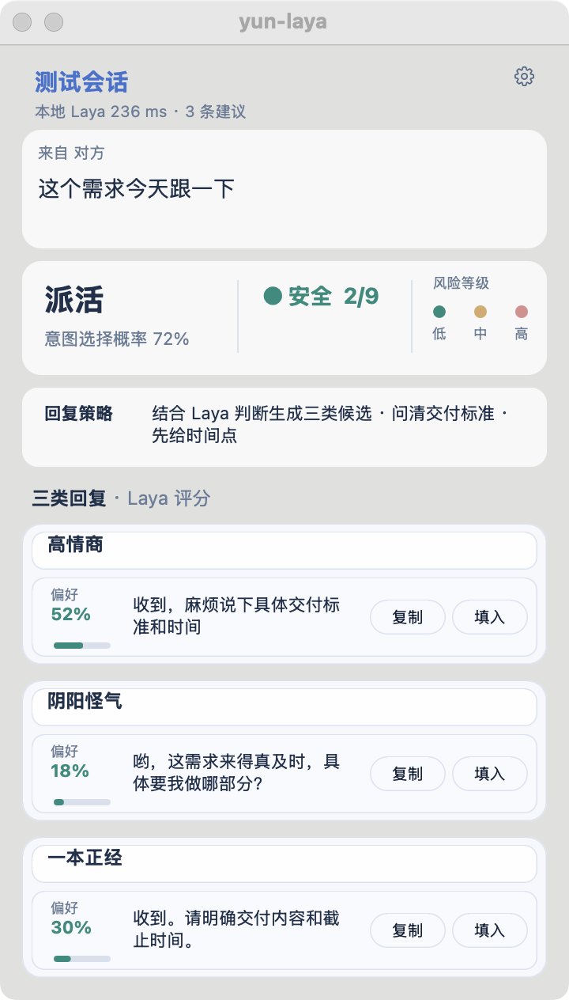

<div align="center">

# yun-laya

### 微信消息来了，先看懂，再决定怎么回。

**macOS 微信回复助手 · 本地 Laya 判断 · 三种语气 · 你来决定发送**

[快速开始](#快速开始) · [界面预览](#先看效果) · [隐私说明](PRIVACY.md) · [反馈问题](https://github.com/lanjunyao/yun-laya/issues)

  

</div>

收到“这个需求今天跟一下”，先看意图、风险和处理建议，再从 **高情商 / 阴阳怪气 / 一本正经** 三种候选中挑一句。无需把每条消息复制到另一个聊天窗口。

如果这个工具解决了你的回复难题，欢迎点右上角 **⭐ Star** 收藏，方便下次找到。

## 先看效果

<p align="center"></p>

*画面使用合成消息；236 ms 是该次预览的显示值，不代表所有设备或消息的速度。*

## 为什么试试它

- **先判断，先展示**：本地 Laya 给出意图、风险、回复策略与本次耗时，生成候选时不用盯着空面板。
- **按需生成**：简单情况使用本地模板；需要措辞时，一次生成请求写出三种语气各一条。点击更多建议才追加生成。
- **保持控制权**：候选可复制或填入，发送由你手动完成；高风险提示自行处理。
- **数据去向清楚**：截图、OCR、判断和排序在本机；云端生成仅发给你配置的服务。本发行版没有共享密钥、默认免费中转或作者服务器。

> 当前是实验性版本。OCR、意图和风险可能出错；尤其是承诺、争议等消息，请自行检查。尚不支持 Windows / Intel Mac。

## 快速开始

需要 **Apple Silicon Mac、macOS 13+、微信、uv 和 Python 3.12**。首次安装需要联网下载依赖与模型，耗时取决于网络和设备。uv 安装见 [官方指南](https://docs.astral.sh/uv/getting-started/installation/)。

```bash
git clone https://github.com/lanjunyao/yun-laya.git
cd yun-laya
uv sync --frozen
uv run python scripts/download_model.py
./start.command
```

模型下载到用户目录，不进入仓库。下载脚本会显示要保存的 `LAYA_MODEL_DIR`；按提示写入 `~/.config/yun-laya/env`。也可用 `.env.example` 创建该配置文件，并将权限设为 `600`。

### 配置写回复的模型

打开模型设置，填自己的 OpenAI 兼容或 Anthropic 兼容 **地址、密钥和模型名**，测试后保存。密钥仅保存在本机仓库外的配置中。**没有配置时不会调用共享服务，生成候选需要先配置；本地判断与模板路径不需要云端密钥。**

使用本地 Ollama，可在设置中填写：

| 字段 | 示例 |
|---|---|
| OpenAI 兼容地址 | `http://localhost:11434/v1` |
| 密钥 | `ollama`（本地占位符） |
| 模型 | 你已通过 Ollama 下载的模型名 |

Ollama 需独立安装并启动；效果取决于所选模型。使用云端 API 会把识别出的消息与近期上下文发送给你选择的服务商，并产生该服务的费用。详见 [PRIVACY.md](PRIVACY.md)。

### 构建桌面应用

安装 Xcode Command Line Tools 后运行：

```bash
./packaging/build_app.sh
open yun-laya.app
```

在系统设置中授予 **yun-laya 屏幕录制权限**，退出重启，再把微信切到前台。填入功能还需要辅助功能权限。菜单栏 **Y** 可暂停、显示面板、打开设置或退出。应用首次运行也需准备依赖；模型权重不随应用包分发。

## 工作原理

```text
微信可见窗口 → 本机截图 / OCR → 本地 Laya 判断（先显示结果）
                                 ├─ 不回复 / 自行处理
                                 ├─ 本地模板：三种语气
                                 └─ 一次生成请求：三种语气
                                      → 本地评分 → 复制 / 填入 → 手动发送
```

不读取微信聊天数据库、不注入微信进程。完整流程见 [架构说明](docs/ARCHITECTURE.md)。

## 开发与反馈

```bash
uv run python -B -m unittest discover -s tests
uv run python -B probe/settings_smoke.py
```

欢迎反馈 OCR 漏识别、意图误判和安装问题。请用虚构消息复现，提交前删除聊天正文、姓名、密钥与个人路径。可从 [Issues](https://github.com/lanjunyao/yun-laya/issues) 提交，贡献方式见 [CONTRIBUTING.md](CONTRIBUTING.md)。

## 来源与许可

基于 [Jev 聊天助手 macOS 版](https://github.com/jev-chat/jev-chat-jarvis-mac) 二次开发，保留 MIT 许可证与上游版权，详见 [LICENSE](LICENSE) / [NOTICE](NOTICE)。本项目与上游作者、微信及腾讯无关联，不代表其出品或背书。

本地判断采用 [Laya](https://github.com/NandhaKishorM/laya)，模型权重单独下载并适用模型自身许可。本仓库不包含权重、个人 API 密钥、运行日志或真实聊天样本。
